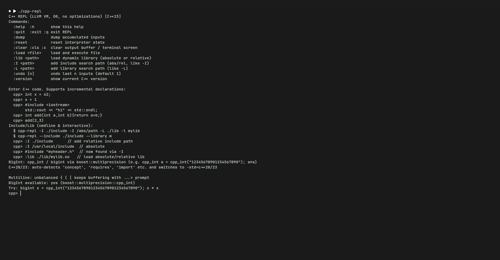

# C++ REPL — VS Code Extension

[](https://github.com/sergiorandria/cpp-repl-vscode/actions/workflows/ci.yml)
[](https://github.com/sergiorandria/cpp-repl-vscode/actions/workflows/codeql.yml)
[](https://github.com/sergiorandria/cpp-repl-vscode/actions/workflows/release.yml)
[](https://opensource.org/licenses/MIT)
[](https://code.visualstudio.com/)
[](https://www.typescriptlang.org/)

Syntax highlighting + REPL integration for **[cpp-repl](https://github.com/sergiorandria/cpp-repl)** — _Python-like incremental REPL for C++ (LLJIT + `clang::Interpreter`)_.



> **No `main()` needed — just raw C++**, like Python. `int x = 42; x+1 → (int) 43`. Even `auto a=9; std::cout << a+b` works **without** `#include <iostream>` (auto-included via `bits/stdc++.h`).

---

## Features

- **TextMate grammar `source.cpp-repl`** for `*.cpprepl`, `*.cpp-repl`, `*.crepl`, `*.crpl`, `*.repl.cpp` and any file with language mode **C++ REPL**
  - REPL prompts `cpp>`, `cpp:c++20 [3] (12ms ✓)>`, continuation `...>`
  - Colon commands: `:help`, `:quit`, `:dump`, `:reset`, `:clear`, `:load`, `:lib`, `:I`, `:L`, `:undo`, `:version`
  - REPL result lines `(int) 43`, `(double) 3.14`, timing `⏱  12ms ✓`
  - Full C++ highlighting: keywords (`concept`, `requires`, `co_await`, `import`, `module` …), types (`int`, `cpp_int`, `bigint`, `std::vector` …), `std::cout/endl`, preprocessor, comments, strings (incl. raw `R"(…)"`), numbers, operators
- **No false squiggles**: `[cpp-repl].C_Cpp.errorSquiggles=Disabled` (auto-include behavior) + `suppressDiagnosticsForRepl()` — `auto a=9; std::cout` is not an error.
- **Language configuration**: brackets, auto-close, comments, indentation, `onEnter` rules.
- **Integrated REPL**
  - `C++ REPL: Start Interactive Session` — opens a terminal running `cpp-repl` (configurable path)
  - `C++ REPL: Run Current File in REPL` — `:load` the active file (keeps incremental state)
  - `C++ REPL: Run Selection in REPL` — send selection (or current line) to the REPL
  - Keybindings: <kbd>Ctrl+Enter</kbd> / <kbd>Cmd+Enter</kbd> → run selection, <kbd>Ctrl+Shift+Enter</kbd> → run file
  - Terminal profile **C++ REPL** visible in _Terminal: Create New Terminal_
  - OutputChannel `C++ REPL` for structured logging
- **Settings**

  | Setting                  | Default    | Description                                                                                              |
  | ------------------------ | ---------- | -------------------------------------------------------------------------------------------------------- |
  | `cppRepl.executablePath` | `cpp-repl` | Path to executable (supports `${workspaceFolder}`); e.g. `${workspaceFolder}/../cpp-repl/build/cpp-repl` |
  | `cppRepl.extraArgs`      | `[]`       | Extra CLI args (`-I`, `-L`, `-l`, `-D`, …)                                                               |
  | `cppRepl.includePaths`   | `[]`       | Include paths (`-I`)                                                                                     |
  | `cppRepl.clearOnRun`     | `false`    | Clear terminal before run                                                                                |

---

## Requirements

- VS Code ≥ 1.85
- `cpp-repl` built (LLVM 22 + Clang): see https://github.com/sergiorandria/cpp-repl

```bash
cmake -B build -DCMAKE_BUILD_TYPE=Debug
cmake --build build -j
./build/cpp-repl --version
```

---

## Quick start

1. Install the `.vsix` (see below) or from Marketplace/OpenVSX.
2. **Set path** if `cpp-repl` is not in `$PATH`:

   ```jsonc
   // .vscode/settings.json
   {
     "cppRepl.executablePath": "${workspaceFolder}/../cpp-repl/build/cpp-repl",
     "cppRepl.includePaths": ["./include"],
     "cppRepl.extraArgs": ["-L", "./lib", "-l", "mylib"],
   }
   ```

3. Open `examples/minimal.cpprepl`:

   ```cpp
   auto a = 9; auto b = 39;

   std::cout << a + b << std::endl; // 48, no #include needed
   ```

   Or `examples/demo.cpprepl` (concepts, bigint, classes).

   Colon commands inside file/REPL:

   ```
   :I ./include
   :L ./lib
   :lib mylib
   :load examples/hello.cpp
   :dump
   :undo
   ```

4. **Run**:
   - `Ctrl+Shift+Enter` → load file in REPL (`:load`)
   - `Ctrl+Enter` → send selection/line
   - `Command Palette → C++ REPL: Start Interactive Session`

   Prompt shows `cpp:c++17 [1]>`, upgrades to `c++20`/`c++23` on `concept`/`import`.

---

## File types

Extension registers `cpp-repl` for:

```
*.cpprepl  *.cpp-repl  *.crepl  *.crpl  *.repl.cpp
```

Manually switch any `.cpp` file to **C++ REPL** via language picker (bottom-right) for REPL-aware highlighting without overriding `source.cpp`. For `*.cpp` files needing cpp-repl semantics without include, prefer `.cpprepl` or switch language to silence `C_Cpp` squiggles (auto-disabled for `[cpp-repl]`).

---

## Architecture (scalable)

```
src/
  extension.ts              # activate() → composition root
  config/index.ts           # CppReplConfig, getConfig(), buildLaunchArgs()
  utils/variables.ts        # resolveVariables() (${workspaceFolder} etc.)
  core/logger.ts            # OutputChannel 'C++ REPL' (info/debug/error)
  terminal/replTerminal.ts  # getOrCreateTerminal(), sendToRepl(), restartTerminal()
  commands/replCommands.ts  # registerReplCommands() (start/restart/runFile/runSelection)
  diagnostics/suppress.ts   # suppressDiagnosticsForRepl()
  test/
    unit/   grammar.test.ts, config.test.ts, variables.test.ts  # mocha tdd, no vscode
    suite/  extension.test.ts                      # @vscode/test-electron
```

Each layer has a single responsibility and stable interface — swap terminal backend, add a new command, or extend `config` without touching the rest.

```
User Input (raw C++ / :command / selection)
        │
        ▼
┌─────────────────────────┐
│  commands/replCommands  │  ← palette, keybindings, menus
└──────────┬──────────────┘
           ▼
┌─────────────────────────┐
│  terminal/replTerminal  │  ← vscode.Terminal lifecycle, sendText, clearOnRun
└──────────┬──────────────┘
           ▼
┌─────────────────────────┐
│   config + variables    │  ← executablePath, extraArgs, ${workspaceFolder}
└──────────┬──────────────┘
           ▼
┌─────────────────────────┐
│ diagnostics/suppress    │  ← configurationDefaults + collection clear
└─────────────────────────┘
```

---

## Development

```bash
git clone https://github.com/sergiorandria/cpp-repl-vscode.git
cd cpp-repl-vscode
npm ci
npm run lint          # eslint
npm run format:check  # prettier
npm run compile       # tsc -> out/
npx mocha --ui tdd out/test/unit/**/*.test.js  # unit
npm test              # vscode integration (xvfb)
npx vsce package --no-yarn  # → cpp-repl-0.3.0.vsix
code --install-extension cpp-repl-0.3.0.vsix
```

- `F5` → Extension Development Host.
- `npm run watch` → background compile.
- `npm run lint:fix` / `npm run format` → auto-fix.

### Scripts

| Script                    | Description                                   |
| ------------------------- | --------------------------------------------- |
| `compile`                 | `tsc -p ./`                                   |
| `watch`                   | `tsc -watch`                                  |
| `lint` / `lint:fix`       | ESLint                                        |
| `format` / `format:check` | Prettier                                      |
| `test`                    | VS Code integration (`@vscode/test-electron`) |
| `test:unit`               | Mocha TDD unit (grammar/config)               |
| `package`                 | `vsce package`                                |
| `clean`                   | remove `out/ *.vsix`                          |

### Project layout

```
.
├── .github/workflows/   # ci.yml, release.yml, codeql.yml
├── .vscode/             # launch.json, tasks.json
├── src/                 # scalable modules (config, terminal, commands, diagnostics, core, utils)
├── syntaxes/            # cpp-repl.tmLanguage.json, cpp-repl-session.tmLanguage.json
├── snippets/            # cpp-repl.json
├── examples/            # demo.cpprepl, minimal.cpprepl, session.crepl
├── language-configuration.json
├── package.json
└── tsconfig.json
```

---

## CI & Quality

- **CI** (`ci.yml`): Node 20/22, `ubuntu-latest`, lint, format:check, compile, unit, grammar validation, package, `xvfb` vscode tests.
- **Release** (`release.yml`): on `v*.*.*` → lint/compile/test → `vsce publish` (Marketplace) + `ovsx publish` (OpenVSX) + GitHub Release.
- **CodeQL** (`codeql.yml`): weekly JS analysis.
- **Dependabot**: npm + GitHub Actions weekly.

Branch protection: require `Build / Test` before merge.

---

## Examples

```bash
# from integrated terminal
cpp-repl examples/hello.cpp examples/class.cpp --no-interactive
# or inside VS Code REPL
:load ../cpp-repl/examples/bigint.cpp
```

See `examples/` and `../cpp-repl/examples/` (`hello.cpp`, `functions.cpp`, `class.cpp`, `bigint.cpp`, `version_concept.cpp`).

---

## Contributing

See [CONTRIBUTING.md](CONTRIBUTING.md). PRs welcome — run `npm run lint && npm run format && npm run compile` before pushing.

## Security

See [SECURITY.md](SECURITY.md). Report privately via GitHub Security Advisories.

## License

MIT — see [LICENSE](LICENSE).
